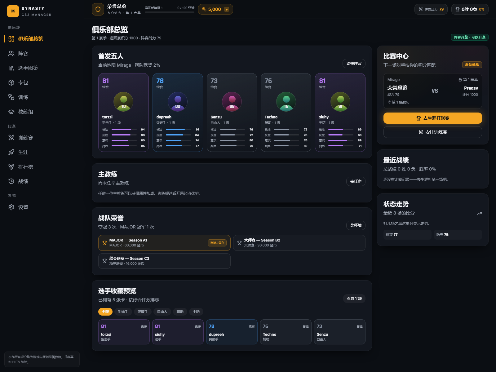
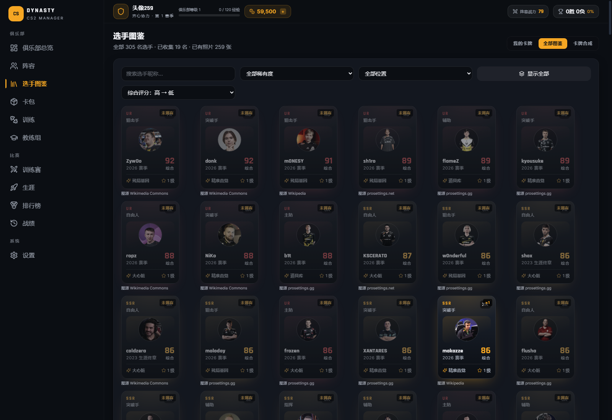
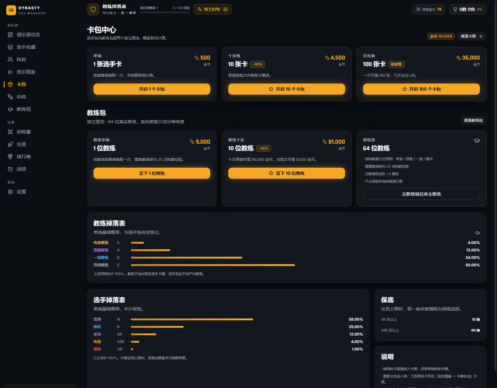
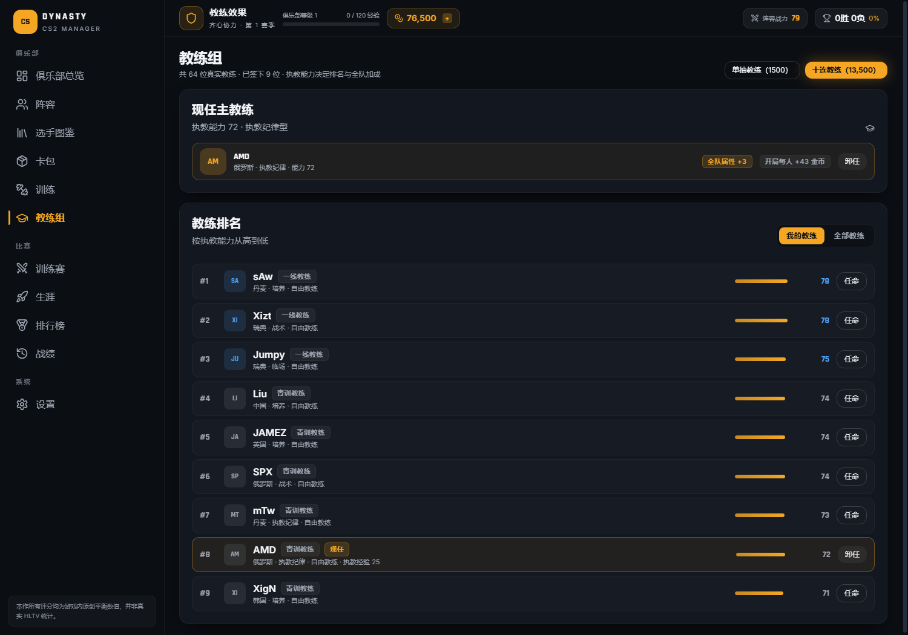

# CS2 Dynasty · CS2 电竞王朝

一款**纯前端、离线可玩**的 CS2 电竞俱乐部经营 + 选手卡牌游戏。
抽卡养卡、组建五人首发、任命主教练、逐回合指挥战术，从公开预选赛一路打进 **MAJOR**。

- 界面全中文，无后端、无账号、无联网请求
- 存档写在浏览器 IndexedDB，支持导出/导入 JSON
- 比赛引擎逐回合模拟（MR12 + 加时），同一 seed 可完整复盘

> **数值免责声明**：选手昵称指向真实 CS 职业选手，但**所有属性、评分、能力值都是本作原创的平衡数据**，不代表 HLTV 统计、也不构成对真实水平的判断。

---

## 截图

| 俱乐部总览 | 选手图鉴 |
| --- | --- |
|  |  |

| 卡包中心 | 教练组 |
| --- | --- |
|  |  |

更多截图见 [`docs/screenshots/`](docs/screenshots)。

---

## 功能特性

### 卡牌与养成
- **305 名选手卡**，5 档稀有度（UR 8 / SSR 20 / SR 45 / R 90 / N 142），按综合评分严格排序
- 综合评分 = 个人能力 62% + 位置熟练 20% + 团队贡献 18%，拆分明细可查
- **等级上限 30**、**星级无上限**：3 张同名卡升 1 星，每星全属性 +3
- 训练、图鉴、卡牌合成三合一页面（我的卡牌 / 全部图鉴 / 卡牌合成）
- 259 名选手使用真实照片（来源见下文），其余使用生成的剪影头像

### 阵容与教练
- 5 个位置：狙击手 / 突破手 / 自由人 / 辅助 / 主防，指挥（IGL）为兼任标记
- 一键自动填充、按地图适应度挑选、团队默契计算
- **64 位真实教练**，按执教能力排行；主教练按风格提供真实收益：
  - 战术型：对手临场适应力下降
  - 纪律型：全队开局额外金币
  - 培养型：训练经验加成
  - 临场型：两者兼顾

### 赛事系统
- **10 档联赛**，MAJOR 为最高档（64 队瑞士轮，7 胜夺冠）
- 三种赛制：单败（1 负出局）、双败（2 负）、瑞士轮三败出局
- 单场对局：7 张地图（Mirage / Inferno / Nuke / Ancient / Anubis / Dust2 / Train），逐回合模拟，含经济、购买、战术克制、加时
- 实时电竞世界：每 60 秒推进一轮 AI 赛事并刷新排行榜

### 经济与外观
- 选手包 500 / 4,500 / 36,000，教练包 1,500 / 13,500（两套独立图池与概率）
- 赛事奖金 2,600 → 60,000（十档递增）
- 俱乐部改名（2,000 金币）、更换徽章与主色（1,500 金币）

---

## 快速开始

需要 **Node.js 18+**（开发时使用 Node 24）。

```bash
npm install
npm run dev        # http://127.0.0.1:5173
npm run build      # 类型检查 + 生产构建到 dist/
npm run preview    # 预览生产包 http://127.0.0.1:4173
npm test           # 81 个自动化测试
```

Windows 下也可直接双击仓库根目录的批处理：

| 文件 | 作用 |
| --- | --- |
| `启动游戏.bat` | 安装依赖（首次）→ 启动开发服务器 → 打开浏览器 |
| `构建并预览.bat` | 构建到 `dist/` 并启动预览 |
| `运行测试.bat` | 运行全部测试 |

---

## 项目结构

```
src/
  app/            应用外壳、路由、导航
  components/     通用 UI、选手卡、头像、雷达图
  data/           选手卡数据、AI 战队、教练、地图、配置、成就
  engine/         评分、阵容、比赛模拟、AI 决策、教练效果
  game/           赛制、赛程、抽卡、成长
  pages/          页面（总览/图鉴/阵容/卡包/训练/教练/训练赛/生涯/排行榜/战绩/设置/战队详情）
  features/       页面内的功能模块
  stores/         Zustand 全局状态（含 IndexedDB 存档）
  tests/          Vitest 测试（引擎、赛制、存档迁移、UI）
docs/screenshots/ 开发过程截图
scripts/          头像导入等维护脚本
```

技术栈：React 18 · TypeScript 5 · Vite 5 · Tailwind 3 · Zustand 4 · Dexie 4 · Vitest 2

---

## 数据与图片来源

- 选手昵称、真实姓名、国籍、年龄：公开资料整理
- 头像：**259 张**来自 [prosettings.gg](https://www.prosettings.gg/counterstrike/)、[prosettings.net](https://prosettings.net/lists/cs2/)、[profilerr.net](https://profilerr.net/cs-go/pro-players/) 与 Wikimedia Commons / Wikipedia，逐张记录来源在 `src/assets/avatars/credits.json`；其余选手使用程序生成的剪影头像
- 地图参数、经济参数、赛制规则：本作原创平衡值
- 未使用任何游戏内资源、贴图或 HLTV 数据

---

## 开发者面板

「设置」里的开发者面板默认**不渲染**。需要时改源码后重新构建：

```ts
// src/data/devFlags.ts
export const ENABLE_DEV_PANEL = false; // 改成 true
```

---

## 测试

```bash
npm test
```

覆盖：评分与成长、三种赛制、加时逻辑、存档迁移、抽卡保底、UI 渲染、教练效果。

---

## License

[MIT](LICENSE) · 仅用于学习与娱乐，不含任何真实赛事/俱乐部的商业授权内容。
